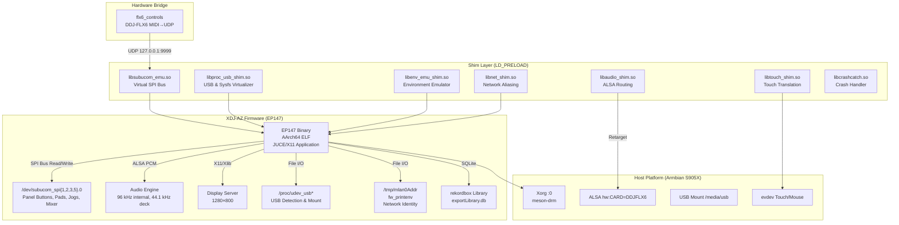

# XDJ-AZ Runtime on Armbian Amlogic S905X — Analisis & Project Plan

> [!IMPORTANT]
> Dokumen ini adalah hasil analisis menyeluruh dari 4 workspace referensi dan current project.
> Siap untuk eksekusi bertahap dengan Git, automated testing, dan CI-ready structure.

---

## 1. Cara Kerja Runtime XDJ-AZ (Raspberry Pi → S905X)

### 1.1 Arsitektur EP147



### 1.2 Perbedaan Kunci Pi 5 vs S905X

| Aspek | Raspberry Pi 5 | Amlogic S905X |
|:---|:---|:---|
| **CPU** | Quad Cortex-A76 (ARMv8.2-A) | Quad Cortex-A53 (ARMv8-A) |
| **Kernel Pages** | 16 KiB → custom jemalloc | **4 KiB** → stock jemalloc OK |
| **Display** | Sway/Wayland + Xwayland | **Direct Xorg `:0`** (lebih ringan) |
| **Sandbox** | bubblewrap + fuse-overlayfs | Direct chroot / namespace |
| **Controller Bridge** | Python MIDI (~20 MB RSS) | **Native C** (<500 KB RSS, <0.2% CPU) |
| **EP147 Binary** | AArch64 native | AArch64 native ✅ |

### 1.3 Alur Data Panel Control (FLX6 → EP147)

```
DDJ-FLX6 USB MIDI → /dev/snd/midi* → flx6_controls (C bridge)
    │
    ├─→ UDP 127.0.0.1:9999 → subucom_emu.so
    │       │
    │       └─→ Virtual /dev/subucom_spi1.0 (ErP: buttons, pads)
    │           /dev/subucom_spi2.0 (Deck 2: jog, tempo)
    │           /dev/subucom_spi3.0 (Mixer: knobs, faders, browse)
    │           /dev/subucom_spi5.0 (Deck 1: jog, tempo)
    │
    └─→ EP147 reads 152-byte MISO frames at ~850 Hz
        EP147 writes 152-byte MOSI LED frames via ioctl
```

### 1.4 Daftar Shim & Fungsinya

| Shim | File | Fungsi |
|:---|:---|:---|
| **subucom_emu** | [subucom_emu.c](file:///p:/az-runtime-lab-main/shims/s905x/src/subucom_emu.c) | Emulasi 4 bus SPI panel XDJ-AZ, CRC-16/X25, UDP/UNIX socket ingress |
| **proc_usb_shim** | [proc_usb_shim.c](file:///p:/az-runtime-lab-main/shims/s905x/src/proc_usb_shim.c) | Redirect `/proc/udev_usb*`, thermal sensor, vsync timing, fallocate |
| **env_emu_shim** | [env_emu_shim.c](file:///p:/az-runtime-lab-main/shims/s905x/src/env_emu_shim.c) | MAC address `/tmp/mlan0Addr`, `fw_printenv` model/boot variables |
| **net_shim** | [net_shim.c](file:///p:/az-runtime-lab-main/shims/s905x/src/net_shim.c) | Pro DJ Link network aliasing `mlan0`→`eth0`/`wlan0` |
| **audio_shim** | [audio_shim.c](file:///p:/az-runtime-lab-main/shims/s905x/src/audio_shim.c) | ALSA retarget ke DDJ-FLX6, channel clamp 8→4 |
| **touch_shim** | [touch_shim.c](file:///p:/az-runtime-lab-main/shims/s905x/src/touch_shim.c) | evdev touch/mouse → EP147 touch protocol + CTM rotation |
| **crashcatch** | [crashcatch.c](file:///p:/az-runtime-lab-main/shims/s905x/src/crashcatch.c) | Signal handler + register dump untuk debugging crash |
| **ximage-fast24** | [ximage-fast24.c](file:///p:/az-runtime-lab-main/shims/ximage-fast24.c) | Accelerated 24-bit X11 rendering |
| **fractional-grid** | [fractional-grid.c](file:///p:/az-runtime-lab-main/shims/fractional-grid.c) | Subpixel waveform rendering |
| **fractional-grid-span** | [fractional-grid-span.c](file:///p:/az-runtime-lab-main/shims/fractional-grid-span.c) | Eliminasi waveform grid stuttering |
| **sem-owner** | [sem-owner.c](file:///p:/az-runtime-lab-main/shims/sem-owner.c) | Fix multi-thread semaphore deadlock |
| **flx6_controls** | [flx6_controls.c](file:///p:/az-runtime-lab-main/shims/s905x/src/flx6_controls.c) | Native C MIDI bridge: 4-deck, 4-ch mixer, jog, pads |

### 1.5 AZ-MODS Integration (Optional Enhancement)

Dari [ARCHITECTURE.md](file:///p:/xdj-az-mods-main/ARCHITECTURE.md):
- **azmod.so** dan **azstem.so** di-load via `LD_PRELOAD` ke EP147
- Menggunakan inline AArch64 hooks pada alamat firmware-specific
- Setiap firmware build diidentifikasi via MD5 `/proc/self/exe`
- Pada S905X, AZ-MODS tetap kompatibel karena EP147 binary identik

---

## 2. Gap Analysis: Apa yang Sudah Ada vs Yang Perlu Dibuat

### ✅ Sudah Ada (di [az-runtime-lab-main](file:///p:/az-runtime-lab-main))

| Komponen | Status | Lokasi |
|:---|:---|:---|
| S905X Shim Sources (8 files) | ✅ Lengkap | [shims/s905x/src/](file:///p:/az-runtime-lab-main/shims/s905x/src) |
| ABI Header (719 lines) | ✅ Lengkap | [xdj_az_abi64.h](file:///p:/az-runtime-lab-main/shims/s905x/include/xdj_az_abi64.h) |
| S905X Makefile | ✅ Lengkap | [s905x/Makefile](file:///p:/az-runtime-lab-main/s905x/Makefile) |
| Display Performance Shims | ✅ 4 files | [shims/](file:///p:/az-runtime-lab-main/shims) |
| Session Launcher (Python) | ✅ | [s905x/session.py](file:///p:/az-runtime-lab-main/s905x/session.py) |
| Shell Launcher | ✅ | [s905x/start-az.sh](file:///p:/az-runtime-lab-main/s905x/start-az.sh) |
| FLX6 Mapping CSV | ✅ | [flx6_mapping.csv](file:///p:/az-runtime-lab-main/shims/s905x/flx6_mapping.csv) |

### 🔲 Perlu Dibuat / Distrukturkan Ulang

| Kebutuhan | Prioritas | Detail |
|:---|:---|:---|
| **Git repository terstruktur** | P0 | Repo baru `xdj-az-s905x` dengan clean C project structure |
| **CMake/Meson build system** | P0 | Menggantikan Makefile manual, cross-compile & CI-ready |
| **Automated test suite** | P0 | Unit tests per shim, integration tests, CI pipeline |
| **Firmware extraction tooling** | P1 | Script otomatis dari ISO → rootfs → verify EP147 hash |
| **Device provisioning** | P1 | One-command deploy ke S905X board |
| **AZ-MODS compatibility layer** | P2 | Ensure azmod/azstem work on S905X sandbox |
| **v2.00 firmware support** | P3 | XDJAZv200 address table, EP147 hash update |

---

## 3. Project Plan: `xdj-az-s905x`

### 3.1 Repository Structure

```
xdj-az-s905x/
├── CMakeLists.txt                 # Top-level build
├── README.md
├── ARCHITECTURE.md
├── BUILDING.md
├── NOTICE.md
├── LICENSE                        # MIT
├── .github/
│   └── workflows/
│       ├── build.yml              # CI: compile all shims
│       └── test.yml               # CI: run unit + integration tests
├── include/
│   └── xdj_az_abi64.h            # Shared ABI definitions
├── src/
│   ├── shims/
│   │   ├── CMakeLists.txt
│   │   ├── subucom_emu.c         # SPI bus emulation
│   │   ├── proc_usb_shim.c       # /proc & sysfs virtualization
│   │   ├── env_emu_shim.c        # fw_printenv & MAC
│   │   ├── net_shim.c            # Pro DJ Link network alias
│   │   ├── audio_shim.c          # ALSA routing
│   │   ├── touch_shim.c          # Touch/mouse translation
│   │   └── crashcatch.c          # Signal handler
│   ├── display/
│   │   ├── CMakeLists.txt
│   │   ├── ximage_fast24.c       # X11 render acceleration
│   │   ├── fractional_grid.c     # Subpixel waveform
│   │   ├── fractional_grid_span.c
│   │   ├── grid_span.c
│   │   ├── grid_span.h
│   │   └── sem_owner.c           # Semaphore fix
│   └── bridge/
│       ├── CMakeLists.txt
│       └── flx6_controls.c       # FLX6 MIDI→SPI bridge
├── tests/
│   ├── CMakeLists.txt
│   ├── test_subucom_crc.c        # CRC-16/X25 validation
│   ├── test_subucom_frames.c     # Frame layout verification
│   ├── test_proc_redirect.c      # Path redirection
│   ├── test_audio_routing.c      # ALSA channel clamp
│   ├── test_flx6_mapping.c       # MIDI→subucom mapping
│   ├── test_env_emu.c            # Environment emulation
│   ├── test_touch_transform.c    # Touch coordinate math
│   └── fixtures/
│       ├── idle_frames.bin        # Captured hardware idle frames
│       └── flx6_mapping.csv
├── scripts/
│   ├── extract_firmware.py        # ISO → rootfs extraction
│   ├── deploy.sh                  # One-command device provisioning
│   ├── start-az.sh                # Production launcher
│   └── session.py                 # Python session supervisor
├── config/
│   ├── session.example.json
│   └── Pioneer-DDJ-FLX6.midi.xml
└── docs/
    ├── how-it-works.md
    ├── hardware-setup.md
    ├── shim-reference.md
    └── troubleshooting.md
```

### 3.2 Timeline (4 Phase, 6 Minggu)

````carousel
### Phase 1: Foundation (Minggu 1-2)

**Goal**: Clean Git repo, compilable, testable

| Task | Deliverable | Test |
|:---|:---|:---|
| Init Git repo dengan structure di atas | `git init` + `.gitignore` | `git status` clean |
| Port semua source dari `az-runtime-lab-main/shims/s905x/` | 8 shim .c files + header | Compiles without error |
| Port display shims dari `az-runtime-lab-main/shims/` | 5 display .c files | Compiles without error |
| Port flx6_controls bridge | `flx6_controls.c` | Compiles without error |
| Setup CMakeLists.txt (top-level + per-directory) | Full build system | `cmake --build` all targets |
| Write unit tests: CRC-16, frame layout, coordinate math | 7 test files | All pass `ctest` |
| Setup GitHub Actions CI | `.github/workflows/build.yml` | Green badge on push |

<!-- slide -->
### Phase 2: Integration (Minggu 3-4)

**Goal**: End-to-end launch on S905X hardware

| Task | Deliverable | Test |
|:---|:---|:---|
| Firmware extraction script | `scripts/extract_firmware.py` | EP147 SHA256 verified |
| Device provisioning script | `scripts/deploy.sh` | One-command deploy |
| Session launcher (start-az.sh) | Production shell launcher | EP147 reaches SOURCE screen |
| Integration tests: shim loading, EP147 startup | `tests/test_integration.sh` | EP147 starts without crash |
| USB mount sequence | proc_usb_shim USB connect flow | USB appears in EP147 browse |
| Touch panel calibration | touch_shim with real CTP | Tap accuracy verified |
| VNC remote access | vncserve / x11vnc | Remote display works |

<!-- slide -->
### Phase 3: Audio & Controller (Minggu 5)

**Goal**: Playable DJ system with audible output

| Task | Deliverable | Test |
|:---|:---|:---|
| Audio routing verified | FLX6 Master + Headphone out | Audible music playback |
| Full FLX6 mapping validation | All controls responsive | Each button/knob mapped |
| Jog wheel calibration | 720 PPR, touch sensitivity | Scratch/nudge works |
| Beat FX anti-glitch | Auto-disengage on channel switch | No audio pop |
| LED feedback | Transport + pad LED mirror | LEDs follow state |
| 4-deck switching | Deck 3/4 via DECK buttons | All 4 decks usable |

<!-- slide -->
### Phase 4: Polish & AZ-MODS (Minggu 6)

**Goal**: Production-ready with optional mods

| Task | Deliverable | Test |
|:---|:---|:---|
| AZ-MODS LD_PRELOAD compatibility | azmod.so + azstem.so load | Mod Menu appears |
| v2.00 firmware address exploration | EP147 hash + addr table stub | Identified or deferred |
| Performance profiling & tuning | CPU/memory benchmarks | <70% CPU sustained play |
| Documentation | Complete docs/ | All sections written |
| Long-session stability | 2+ hour test | No crash or memory leak |
| Release packaging | `make dist` tarball | One-command install |
````

---

## 4. Build System (CMake)

```cmake
# Top-level CMakeLists.txt (key structure)
cmake_minimum_required(VERSION 3.16)
project(xdj_az_s905x C)

set(CMAKE_C_STANDARD 11)
set(CMAKE_C_FLAGS "${CMAKE_C_FLAGS} -Wall -Wextra -fPIC -D_GNU_SOURCE")

# Shared ABI header
include_directories(${CMAKE_SOURCE_DIR}/include)

# Shim shared libraries (LD_PRELOAD targets)
add_subdirectory(src/shims)

# Display optimization shims
add_subdirectory(src/display)

# FLX6 controller bridge (standalone executable)
add_subdirectory(src/bridge)

# Tests
enable_testing()
add_subdirectory(tests)
```

### Cross-compilation:
```bash
# Native on S905X (Armbian)
cmake -B build -DCMAKE_BUILD_TYPE=Release
cmake --build build -j4

# Cross-compile from x86_64
cmake -B build \
  -DCMAKE_C_COMPILER=aarch64-linux-gnu-gcc \
  -DCMAKE_BUILD_TYPE=Release
cmake --build build -j$(nproc)
```

---

## 5. Test Strategy

### 5.1 Unit Tests (Offline, Host-runnable)

| Test | Validates | Method |
|:---|:---|:---|
| `test_subucom_crc` | CRC-16/X25 per bus (28/38/96 bytes) | Compare against captured frames |
| `test_subucom_frames` | 152-byte frame layout, field offsets | Bit-exact with hardware captures |
| `test_proc_redirect` | Path rewriting `/proc/udev_usb1` → `/tmp/...` | String comparison |
| `test_audio_routing` | Channel clamp 8→4, device name redirect | Mock ALSA calls |
| `test_flx6_mapping` | MIDI note/CC → subucom byte mapping | All 200+ controls from CSV |
| `test_env_emu` | `fw_printenv` output format | String match |
| `test_touch_transform` | Coordinate transform matrix | Integer math assertions |

### 5.2 Integration Tests (On-device)

```bash
# Smoke test: all shims load without symbol errors
LD_PRELOAD="libsubucom_emu.so:libproc_usb_shim.so:..." /bin/true

# EP147 startup test: reaches SOURCE screen within 30 seconds
timeout 60 ./start-az.sh --test-mode

# USB mount test: simulated USB insert → EP147 sees library
echo "connect,mount /media/usb/sda1 vfat" > /tmp/xdj_az_proc/udev_usb1
```

### 5.3 CI Pipeline

```yaml
# .github/workflows/build.yml
name: Build & Test
on: [push, pull_request]
jobs:
  build:
    runs-on: ubuntu-latest
    steps:
      - uses: actions/checkout@v4
      - name: Install AArch64 cross-compiler
        run: sudo apt-get install -y gcc-aarch64-linux-gnu libasound2-dev:arm64
      - name: Configure
        run: cmake -B build -DCMAKE_C_COMPILER=aarch64-linux-gnu-gcc
      - name: Build
        run: cmake --build build -j$(nproc)
      - name: Unit Tests (QEMU)
        run: |
          sudo apt-get install -y qemu-user-static
          cd build && ctest --output-on-failure
```

---

## 6. Risk Register

| Risk | Impact | Mitigation |
|:---|:---|:---|
| S905X CPU too slow for EP147 | Audio underruns, UI lag | Profile early; sem-owner fix + jemalloc already address main bottlenecks |
| v2.00 firmware different ABI | Shims crash or malfunction | Maintain separate address tables per firmware hash |
| ALSA device format mismatch | Silence or distortion | audio_shim probes format and negotiates; verified S24_3LE path from rbp |
| Touch calibration drift | Wrong tap positions | touch_shim CTM matrix; `xinput` calibration script |
| AZ-MODS hook conflicts | Crash on mod load | AZ-MODS' own firmware-ID gate rejects unknown builds safely |

---

## 7. Immediate Next Steps

> [!TIP]
> Saya merekomendasikan memulai dari **Phase 1** sekarang — membuat Git repo terstruktur dan memporting semua source yang sudah ada.

1. **Inisialisasi Git repo** di `p:\xdj-az-s905x\` atau lokasi yang Anda tentukan
2. **Port source files** dari `az-runtime-lab-main/shims/s905x/` ke struktur baru
3. **Setup CMake build system** dengan cross-compile support
4. **Write first unit test** (`test_subucom_crc`) sebagai proof of concept
5. **Commit awal** dengan proper `.gitignore` dan README

Apakah Anda ingin saya langsung mulai membuat repository dan memporting source code?
